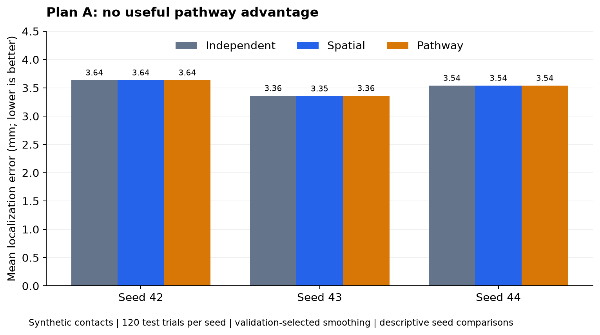
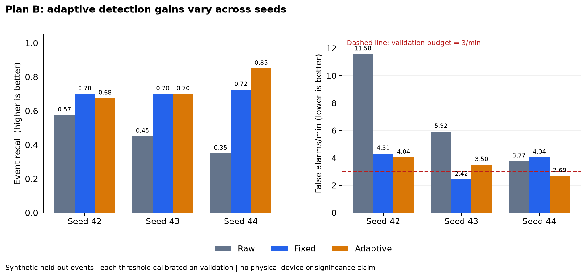
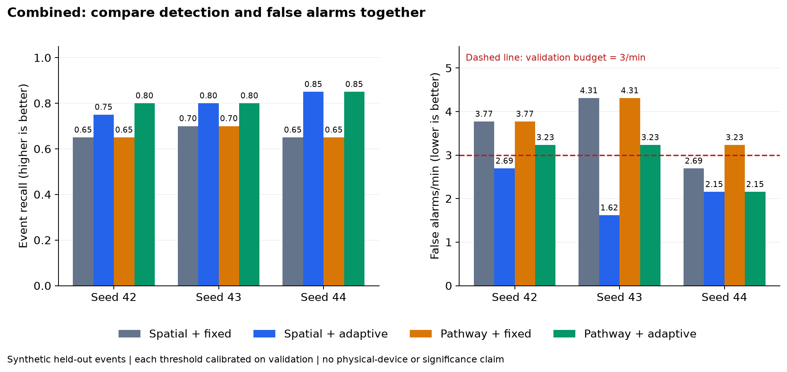

# RP Hand · Tactile Research Lab

[Run the lab](RESEARCH_QUICKSTART.md) · [Knowledge library](knowledge/README.md) · [Results](reports/README.md) · [Project plans](PROJECT_PLANS.md) · [Validation](VALIDATION.md)

This fork combines English RP Hand documentation with **two runnable tactile-processing research prototypes**: a pathway graph for combining sensor readings, and an adaptive receiver for detecting events in noisy signals. It includes shared evaluations, CSV replay, and a 40-chapter learning library explaining the definitions, equations, assumptions and code.

**Current status:** the software works on synthetic data and offline recordings. No physical RP Hand, tactile acquisition, real slip detection or closed-loop grasp has been validated. The research package sends no hardware commands.

## What has been built

| Component | Implementation |
| --- | --- |
| Plan A: pathway graphs | A 4×4 sensor patch, independent/spatial/pathway baselines, missing-aware diffusion, contact localization, validation-selected smoothing and paired bootstrap comparisons |
| Plan B: adaptive receiver | Causal baseline removal, envelope tracking and noise normalization; raw/fixed/adaptive comparisons; training-only noise fitting and validation-only threshold selection |
| Combined experiment | Spatial/pathway graph × fixed/adaptive receiver on the same synthetic multichannel recordings |
| Evaluation | Disjoint training/validation/test groups, event recall, false alarms, detected-event latency, parameter ablations and three-seed studies |
| Supporting tools | Calibration, timestamp/coverage checks, CSV replay, offline coherence/lag diagnostics and a pure grip-policy example with decision guards |
| Learning resources | 40 concept chapters, glossary, equation ledger, worked examples and links into code/tests |

The two ideas draw inspiration from body-meridian pathways and A. Meridian's receiver framework. Here, “pathway” means an explicit graph over sensors and “adaptive receiver” means a causal signal-processing algorithm. The experiments do not establish biological meridians, consciousness reception or other speculative mechanisms.

## What the results say

All graphs below are generated from the [committed study artifacts](reports/robustness/SUMMARY.md). They show three generator seeds, not three physical replications. No cross-seed significance claim is made.

### Plan A: the pathway map did not improve localization



Lower error is better. On seeds 42 and 44, validation selected **zero smoothing** for both graphs, making their predictions identical to the independent baseline. On seed 43, spatial smoothing reached **3.3536 mm** mean error versus **3.3607 mm** for the pathway model. None of the seeds demonstrated the benchmark's useful pathway advantage.

This is a negative result for the particular column-based pathway map and synthetic Gaussian contact generator. It does not rule out every graph design. The JSON reports also retain a fixed-strength comparison so that zero smoothing does not hide topology differences.

### Plan B: adaptation helps in some conditions, but not consistently



Recall is the fraction of labeled events detected. False alarms/minute measures unwanted alarm episodes during observed background time. **Both matter:** a detector can increase recall simply by becoming easier to trigger.

Adaptive versus fixed recall was **67.5% vs 70%**, **70% vs 70%**, and **85% vs 72.5%** for seeds 42–44. Adaptive false-alarm rates were **4.04, 3.50 and 2.69/minute**. The threshold search met a 3/minute budget on validation data, but that budget did not reliably hold on test data. Adaptation is a candidate to investigate further, not a demonstrated universal improvement.

### Combined experiment: adaptation is more promising than this pathway topology



Adaptation increased recall within both graph choices on these three multichannel sets. Pathway topology had **no consistent advantage over the spatial graph**, and sometimes produced more false alarms. Each condition has its own validation-calibrated threshold; these are operating-point comparisons, not matched test false-alarm rates.

The [full results](reports/README.md) include adaptation ablations and per-trial records. Latency is reported only for detected events and must be read alongside missed events. The ablation study uses fewer trials per scenario than the standalone receiver study, so their summary numbers are not interchangeable.

**Interpretation limit:** these are development benchmarks. The threshold grid was improved after inspecting early results, so this is not an untouched confirmatory study. Freeze the code and evaluate newly acquired data before making a hardware-performance claim.

## Run and reproduce

Requires Python 3.10 or newer. Inside an activated virtual environment:

```bash
python -m pip install -e ".[dev]"
python -m pytest -q
python -m tactile_lab benchmark --experiment all --output runs/demo
python -m tactile_lab sweep --seeds 42 43 44 --output runs/robustness
```

See the [quickstart](RESEARCH_QUICKSTART.md) for Windows/Linux setup and CSV replay. Runs save configuration hashes, validation candidates, test-trial metrics, Markdown summaries and execution provenance.

**Executed validation:** 154 tests passed; all four seed-42 scientific JSON files reproduced byte for byte; wheel packaging and example CSV replay succeeded. See the [validation record](VALIDATION.md) for environment details and boundaries. Remote CI success is not claimed by that local record.

To regenerate the figures from the saved JSON without rerunning experiments:

```bash
python -m pip install matplotlib
python scripts/plot_results.py
```

PNG and SVG versions are saved in `assets/research/`. The plotting dependency is optional and is not needed to run the lab.

## Learn how it works

Start with the [knowledge library](knowledge/README.md), then follow an equation into its implementation and tests.

| Learning goal | Reading route |
| --- | --- |
| Understand measurements | Chapters 01–08: evidence, units, sampling, noise, calibration, missing data and causality |
| Build the pathway experiment | Chapters 13–20: graphs, mappings, Laplacians, diffusion, localization and splits |
| Build the receiver | Chapters 09–12 and 21–24: filters, envelopes, adaptation, thresholds and event metrics |
| Evaluate a claim | Chapters 25–29 and 36: uncertainty, controls, combined experiments and reading results |
| Move toward a robot | Chapters 32–34 and 37: lag, fusion, bounded decisions and contact mechanics |

Use the [glossary](knowledge/GLOSSARY.md) for terminology and the [equation ledger](knowledge/EQUATION_LEDGER.md) for symbols, computational roles and code references. Background theory is distinguished from operations actually implemented.

## Next physical milestone

Keep the independent/spatial and fixed-filter baselines. Acquire a calibrated sensor stream with timestamps and independent event labels; compare frozen methods on new sessions and objects. Progress from offline replay to observation-only operation before considering bounded grip adjustment. The [project plan](PROJECT_PLANS.md) lists hardware acceptance gates; [implementation status](IMPLEMENTATION_STATUS.md) distinguishes completed software from pending physical integration.

## RP Hand hardware and English documentation


*Upstream product demonstration; not footage of these research prototypes.*

RP Hand has **11 mechanical degrees of freedom and 6 actively controlled axes**. The maintained Linux CAN-FD driver is provided separately in [roboparty_dexhand](https://github.com/Roboparty/roboparty_dexhand).

| Product specification | Documented value |
| --- | --- |
| Dimensions | 147.54 × 73.53 × 26.35 mm |
| Weight | 379 g ± 10 g |
| Transmission | Worm gear |
| Active axes | 6, with 5 additional passive/coupled degrees of freedom |
| Tactile sensing | Optional; not exposed by the driver API in the documented snapshot |

Specifications and compatibility statements below describe the translated documentation snapshot, not a fresh upstream release audit. Confirm the supplied hardware revision and selected driver version before integration.

[Hardware](docs/hardware.md) · [Bring-up](docs/quickstart.md) · [SDK](docs/sdk.md) · [ROS 2 compatibility](docs/ros2.md) · [Models and CAD](docs/models.md) · [Downloads](docs/downloads.md) · [Troubleshooting](docs/troubleshooting.md) · [Translation scope](docs/translation-status.md)

## Software Scope

| Component | Role and current scope |
| --- | --- |
| [roboparty_dexhand](https://github.com/Roboparty/roboparty_dexhand) | Maintained Linux CAN-FD C++ driver, `dexhand_py` bindings and feedback configuration CLI; amd64 and arm64 packages |
| [roboparty_dexhand_ros](https://github.com/Roboparty/roboparty_dexhand_ros) | One process per hand, command topics and initialization/reset services; see the ROS guide for version differences and current limitations |
| Vendor SDK and applications | Separate packages and examples, including other operating systems and transports; see the download table for availability |

The current RoboParty SDK route supports Linux CAN-FD and six active axes. Product-level Windows, EtherCAT, RS485 and tactile capabilities do not imply support in this wrapper. Two hands require separate OS processes. Driver getters return cached feedback.

The SDK documentation targets an Ubuntu 24.04 / Python 3.12 image; the current ROS README documents Ubuntu 22.04 / Python 3.10 / Humble. A combined Jazzy deployment is not presented here as verified. Use the [compatibility guide](docs/ros2.md) before combining packages.

## Resources and Maintenance

Dimensions and connector drawings are available locally in this repository. Twelve original software, model, CAD and protocol attachments are recorded upstream as archived in the private prerelease [resources-2026.10.05](https://github.com/Roboparty/rp_dexhand/releases/tag/resources-2026.10.05), with source records, file sizes and SHA-256 checksums in [Downloads](docs/downloads.md). Upstream access may be required; release attachments are not included in this fork. This resource snapshot is not a new SDK release or a hardware-validation result; maintained RoboParty driver releases are linked directly.

Report product-documentation issues in [this repository](https://github.com/Roboparty/rp_dexhand/issues), driver issues in [roboparty_dexhand](https://github.com/Roboparty/roboparty_dexhand/issues), and ROS integration issues in [roboparty_dexhand_ros](https://github.com/Roboparty/roboparty_dexhand_ros/issues).

[Source records and update procedure](docs/maintenance.md) | [Third-party and asset notices](NOTICE.md)
