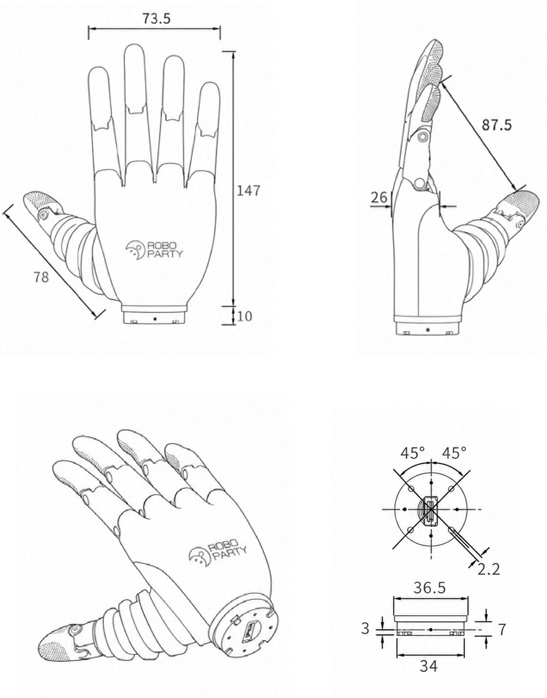
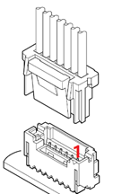

# 硬件手册

[返回首页](../README.zh-CN.md) · [English](en/hardware.md) · [快速开始](quickstart.md) · [模型下载](models.md)

## 产品与尺寸

RP Hand 采用蜗轮蜗杆传动，具有 11 个机械自由度和 6 个主动控制轴。当前 `rphand` SDK 提供六轴控制接口；11 个机械自由度中包含 5 个被动 / 联动自由度。

| 参数 | 手册记录 |
| --- | --- |
| 外形尺寸 | 147.54 × 73.53 × 26.35 mm |
| 重量 | 379 g ± 10 g |
| 拇指侧摆范围 | 0°～87.5° |
| 拇指屈伸范围 | 0°～65° |
| 四指弯曲范围 | 0°～72° |
| 静态电流 | ≤ 0.1 A |
| 最大电流 | ≤ 2.5 A |
| 最小开合时间 | ≤ 0.7 s |
| 工作环境 | -10～45 °C，10%～90% RH |
| 存储温度 | -10～70 °C |
| 防护等级 | IP30 |

图中部分标注使用取整值，参数表保留手册中的精确数值。加工与安装应使用对应硬件修订的模型和工程图；这些参数不是逐轴软件限位或负载标定结果。

## 引脚与供电

| 引脚 | 信号 | 用途 |
| --- | --- | --- |
| 1、2 | VDC | 电源输入 |
| 5、6 | GND | 电源地 |
| 3 | CANH | CAN-FD 差分信号 |
| 4 | CANL | CAN-FD 差分信号 |

产品手册标注电源范围为 `12 V (-10%) ～ 48 V (+10%)`。实际接线前以所交付型号、铭牌和配套电源要求为准；本页不将范围上限作为推荐工作电压。按图中的插头/插座视角辨认针位，不能从导线颜色推断极性。断电完成插接和线序检查，再按设备上电流程供电。

本指南仅说明 CAN-FD 设备配置。其他通信方式需要匹配的设备固件与接线，不可仅换线套用。

## CAN-FD 接入

需要 Linux 支持的 CAN-FD 适配器。普通 CAN 适配器不能替代 CAN-FD 适配器。实际线束、终端电阻、接地与供电方案需与交付设备匹配。

| 配置项 | 当前 SDK 部署说明 |
| --- | --- |
| 名义速率 | 1 Mbps |
| 数据速率 | 5 Mbps |
| node ID | 1～127，与设备实际配置一致 |
| 单手接口示例 | `can0`，必须按实际连接调整 |
| 下游双手接口示例 | 左 `can0`、右 `can3`；不是设备自动识别结果 |
| 双手 node ID | 两条独立总线可各用 1；同一总线不可存在冲突 ID |
| 反馈配置 | 当前 SDK connect 配置并检查 20 ms 周期反馈 |

接口配置见[快速开始](quickstart.md)。SDK 不创建系统接口或修改总线速率。连接前先停止占用相同接口和节点的其他程序。

## 主动轴、左右手与模型

当前 SDK 的轴 ID 为 1～6，顺序为拇指侧摆、拇指屈伸、食指、中指、无名指、小指；单轴 API 不接受广播 ID 0。软件位置使用行程当量，不能直接等同于手册角度。

左右手零位、方向和设备行程到模型弧度的转换需要按交付配置确认，见[模型说明](models.md)。当前开发路线不包含触觉读取接口，本仓库不将原版资料中的选配传感器列为已集成功能。

## 养护

定期清洁外表面，避免清洁液进入掌内。需要校正、拆装或检修时联系产品维护人员。质保与售后以适用销售条款为准。

资料来源：[RP Hand 用户手册](https://roboparty.feishu.cn/docx/SaoIdLjNeoOCVZxXzdIcqwLqnNb)，revision 13，核对日期 2026-10-05；原始飞书页面需要相应访问权限。
